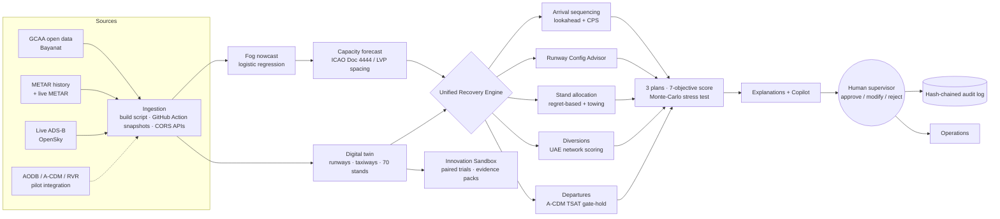

# FalconAero: AI Disruption Recovery for UAE Airports

**UAE Hackathon 2026 · Track 2 (Pioneers) · Theme: Responsible AI & Smart Cognitive Government**
**Challenge (GCAA):** *Intelligent Air Traffic Flow & Operations Management*

### ▶ Live demo: **https://rithikhc.github.io/FalconAero/**
### ▶ Auto-play pitch demo: **https://rithikhc.github.io/FalconAero/?demo**

> FalconAero is an explainable, human-in-the-loop AI decision-support system that helps air navigation service providers, airports and air traffic controllers recover from fog, sandstorms, runway closures and emergencies.
> It plans **runway sequencing, landing-stand allocation, taxi flow, towing, departure gate-holding and UAE-wide diversions together**, in under 0.1 s, and explains every decision.
> The same digital twin doubles as an **Innovation Sandbox**, so GCAA staff can test their own operational ideas on simulated disruption days before piloting them.

No install, no login, no backend. Everything (simulation, optimisation, AI model, charts) runs in your browser. It works offline too: download the repo and open `index.html`.

---

## 1. The problem, read carefully

The challenge profile has **two layers**, and FalconAero answers both.

| Layer | What it says | FalconAero's answer |
|---|---|---|
| **How-Might-We (operational)** | Immediate, accurate, reliable decisions on aircraft movement and **landing-stand allocation** during fog or emergency weather, under time pressure, limited stands and multiple aircraft priorities, using AI, real-time data and ANS ↔ airport integration | **Ops Center + Unified Recovery Engine**: fog nowcast → capacity forecast → 3 jointly-optimised recovery plans → explanations → human approval → audit |
| **Problem statement (institutional)** | GCAA ideas stay unimplemented because experimentation, testing and implementation support are not accessible (root causes **R1–R5**) | **Innovation Lab**: the digital twin becomes a sandbox where anyone turns an idea into a paired, reproducible experiment, gets an evidence pack and readiness score, and moves it through a governed pipeline to a pilot |

The pain is real and recent. Fog forced **19 inbound diversions at DXB on 20 Nov 2025** ([Gulf News](https://gulfnews.com/business/aviation/19-inbound-flights-diverted-as-fog-causes-flight-disruptions-at-dubai-international-airport-1.500353607)) and **23 on 3 Jan 2026** ([Khaleej Times](https://www.khaleejtimes.com/business/aviation/23-inbound-flights-diverted-dubai-airports-fog-jan-3-morning)).

---

## 2. What you can do in the prototype

| Tab | What it shows |
|---|---|
| ⚡ **Command** (landing screen) | One-screen presentation dashboard: live airport map, 6 big KPIs, AI fog radar, live AI-action feed, **runway status and resource utilisation**, UAE network mini-map, **⚡ AI RECOVER → plan cards → ✔ APPROVE**, and a **BEFORE ⟷ AFTER** toggle. **Click any stand or runway to disrupt it**: every plan is re-computed instantly and the reassignments and alternatives pop up. Click any aircraft for a compact "why" card |
| 🛰 **Ops Center** | Live digital twin of DXB (stylised): 80 arrivals and 54 departures, 70 stands, 2 runways and taxiways, animated aircraft, fog layer. Five scenarios: Normal, Dense Fog (CAT III / LVP), Shamal sandstorm, Runway closure, **Perfect Storm** (fog + MAYDAY fuel + medical + jet-bridge failure). AI fog nowcast with reasons. One-click recovery plans, **Approve / Modify / Reject**, click any aircraft for **"Why?"**. **Copilot** takes text or 🎤 voice, in English or Arabic, for briefings and what-ifs ("close runway 30R for 40 min") |
| 🧠 **Recovery Plans** | Four complete plans side by side (current practice, Balanced, Min-Delay, Max-Safety): 20 KPIs, trade-off radar, runway-sequence waterfall (airborne holding vs ground delay), stand-allocation Gantt chart, full decision log |
| 🇦🇪 **UAE Network** | National view across 7 UAE airports: live METAR and ADS-B traffic, alternate scoring (weather, Code-F stands, apron capacity), diversion flows for current practice vs FalconAero |
| 📊 **Data & Evidence** | Official **GCAA open data from Bayanat** (movements, passengers, daily international movements), 11 years of real OMDB METARs, an original **fog-impact study**, data pipeline, data catalogue and data gaps |
| 🧪 **Innovation Lab** | Idea pipeline (Submitted → Sandbox-tested → Validated → Pilot → Scaled), experiment builder with 8 policy levers, paired Monte-Carlo trials with 95% bootstrap confidence intervals, safety guardrails, readiness score, printable evidence pack, recognition board |
| ⚖ **Responsible AI** | Principles mapped to working mechanisms, live **SHA-256 hash-chained audit trail** (verify / simulate tampering / export), human-oversight metrics, airline fairness dashboard, model cards, a list of what the AI will never do |
| 📈 **Impact & Roadmap** | Live benchmark (32 disruption days), annualised value with editable assumptions, **90-day pilot plan**, risk register, business model canvas and pricing, strategic alignment |

---

## 3. Innovations (what's new)

1. **Unified Disruption-Recovery Engine.** Runway sequencing, stand allocation, towing, departure gate-holding and diversions are optimised **jointly**, so a change in one resource is costed in all the others. Today these are separate tools and phone calls.
2. **Runway Configuration Advisor.** When the airborne backlog builds, it proposes opening 12R/30L to arrivals (mixed mode) for bounded windows, then absorbs the knock-on effects (departure slips, blocked stands) with tows and remote stands.
3. **Predict, don't react.** A fog nowcast **trained on 11 years of real OMDB METARs** (time-split validated on 2023–2025: ROC-AUC 0.999, caught 5 of 6 fog onsets an hour ahead) raises the alert ~30 min before visibility collapses. FalconAero then turns airborne holding into **ATFM ground delay at origin** for short-haul flights that haven't departed yet.
4. **Fuel-aware, priority-aware sequencing.** A lookahead heuristic with constrained position shifting (±k fairness bound) weighs MAYDAY and medical flights, fuel slack, wake pairs, passengers and transfer connections.
5. **Proactive, network-aware diversions.** It decides 25 min before arrival rather than at minimum fuel. It picks the flight with the least passenger impact and an alternate scored on weather, Code-F stands and apron load, so aircraft are never sent into another fog bank.
6. **Taxiway network with conflict-free routing.** The manoeuvring area is a connected graph. Current practice uses fixed standard routes, and head-on, crossing and spacing conflicts are detected. FalconAero routes every movement with time-dependent Dijkstra plus a reservation table (cooperative path-finding): it may pick another connector or hold short for a few seconds, and the result is zero conflicts.
7. **Wake-aware departure sequencing.** ICAO time-based wake separation behind Heavy and Super aircraft, with bounded position shifts.
8. **Live disruption → instant re-plan.** Click a stand or runway to take it out of service. All plans are recomputed (~0.1–0.2 s) and the affected flights get new stands with ranked alternatives.
9. **Regret-based stand allocation with towing.** Hard constraints cover ICAO Annex 14 code letters, outages and buffers. Soft costs cover remote/bussing, airline terminal, code waste, ambulance access and transfer walk.
10. **Explainable by default.** Every decision shows its reasons, the alternatives rejected and what current practice would have done. The fog model shows each factor's contribution.
11. **Stress-tested plans.** Monte-Carlo ETA-noise runs report how stable each plan is.
12. **Seven-objective scoring including controller workload and airline fairness.** The AI won't recommend a plan that overloads humans.
13. **Human-in-the-loop with a tamper-evident audit.** Supervisors approve, modify or reject every plan. Every recommendation, approval and override is hash-chained.
14. **Bilingual voice Copilot (EN/ع).** Briefings and what-ifs, answered only from computed plan data (no hallucinated numbers).
15. **Innovation Sandbox for GCAA.** It turns the digital twin into an experimentation platform with paired trials, confidence intervals, safety guardrails, sign-off gates (R2) and stage analytics (R4).

---

## 4. Results (computed by the prototype)

Benchmark: **32 disruption days** (4 scenarios × 8 seeds). The same traffic runs under current practice (first-come-first-served, fixed stand plan, late nearest-airport diversion) and under FalconAero's recommended plan.

| KPI (mean per disruption day) | Current practice | FalconAero | Change |
|---|---:|---:|---:|
| Average arrival delay incl. diversions | 15.2 min | 8.6 min | **−43%** |
| Passenger-delay hours | 5,080 h | 2,800 h | **−45%** |
| Airborne holding | 831 min | 299 min | **−64%** |
| CO₂ from holding, queues and diversions | 238 t | 101 t | **−57%** |
| Diversions (all into fields also in fog) | 0.31 | 0 | **−100%** |
| Aircraft reaching minimum fuel | 0.31 | 0 | **−100%** |
| Stand conflicts | 4.8 | 0 | **−100%** |
| **Taxi conflicts** (head-on / crossing / spacing) | 9.3 | 0 | **−100%** |
| Emergency landing delay | 4.5 min | 0 min | **−100%** |
| Runway throughput (arrivals landed by 08:00) | 73.5 | 78.5 | **+7%** |
| Stand utilisation (avg) | 61% | 66% | **+5 pts** |
| Re-planning time (all plans) | n/a | **~76 ms per plan** | |

In the **Perfect Storm** demo day: average delay **30 → 12 min**, diversions **3 → 0**, conflicts **37 → 0**, MAYDAY lands with **0 min** delay.
*All traffic is synthetic but calibrated to GCAA volumes; separation follows ICAO Doc 4444 minima. The Impact tab recomputes these numbers live in your browser.*

---

## 5. Data: official UAE open data plus real observations

| Source | Publisher / portal | Used for |
|---|---|---|
| [Aircraft Movements Per Emirate Yearly](https://bayanat.ae/en/Datasets/Dataset-info?id=kxuZ3oMVtzE4Y81JnazA9mimspukxqTE2PkLqk0_aHY) (2014–2023) | **GCAA** via **Bayanat** | Calibrating simulated traffic (Dubai 2023: 450,691 movements ≈ 25.7 arrivals/h) |
| [Passengers Per Emirate Yearly](https://bayanat.ae/en/Datasets/Dataset-info?id=raIY5qaSUK-sIdyuF0PToYl1x5nSINLVXadeztkQgyk) (2016–2023) | **GCAA** via **Bayanat** | Passenger-impact scaling (UAE 2023: 132.5 M) |
| [International Aircraft Movements](https://bayanat.ae/en/Datasets/Dataset-info?id=SPineUQC-jJj32JHqshQ_NkgTg-M0TG0bpBucVBkcOg) (monthly 2018–2026, daily 1998–2023) | **GCAA / Sheikh Zayed Air Navigation Centre** via **Bayanat** | Seasonality; **fog-impact study** |
| [Number of Fog Days by Station and Month](https://bayanat.ae/en/Datasets/Dataset-info?id=X0y7KIXasWuUW8i-lEmNURZJOAEuilU1t-3RBP1zkOs) (2017) | FCSC / NCM via Bayanat | Cross-check of fog climatology |
| OMDB / OMAA / OMDW METAR 2015–2025 | [Iowa Environmental Mesonet](https://mesonet.agron.iastate.edu/request/download.phtml) | Training the fog nowcast; fog-day detection |
| Live METAR · live ADS-B | NOAA AWC · OpenSky Network (snapshotted by a GitHub Action) | Live weather and traffic over the UAE |
| Live weather | Open-Meteo (CORS API) | Live fallback |

**Original finding (fog-impact study):** across **39 OMDB fog days** (2015–2022), UAE international arrivals were only **−1.1%** below matched non-fog days (worst day **−9.7%**). Fog rarely cancels flights. Its cost is **delays, holding, diversions and missed connections**, which is exactly the minute-level decision space FalconAero targets. Reproduce with `node tools/build_opendata.cjs`.

Data gaps and how the pilot closes them (stand-level AODB, A-CDM milestones, RVR, NCM observations) are listed in the **Data & Evidence** tab. GCAA data is licensed CC BY-SA 4.0 (© GCAA).

---

## 6. How it works



**AI and algorithms**
- **Fog nowcast:** L2-regularised logistic regression on 13 engineered METAR features (dew-point depression, RH, wind, hour and season cycles, visibility and trends). Time-based split (train 2015–2022, test 2023–2025). See [`docs/FOG_MODEL.md`](docs/FOG_MODEL.md).
- **Sequencer:** one-step-lookahead weighted-delay minimisation with constrained position shifting, wake-turbulence separation matrix, LVP spacing, mixed-mode gaps and an emergency override.
- **Stand allocator:** regret-based batch assignment with hard constraints (code letter, overlap + buffer, outages) and a soft cost model, plus towing generation.
- **Diversion planner:** iterative fuel-breach detection, least-passenger-impact selection, network alternate scoring.
- **Scorer:** Safety 28%, Delay 20%, Passengers 14%, Sustainability 10%, Stands 10%, Workload 10%, Fairness 8%.

---

## 7. Responsible AI

- **Human oversight:** the AI recommends and humans decide. It never issues ATC clearances or overrides the pilot-in-command.
- **Explainability:** per-decision reasons and alternatives, fog-factor contributions, model cards.
- **Safety:** hard constraints (separation, stand codes, fuel guardrails), robustness tests, a sandbox guardrail that blocks unsafe ideas.
- **Fairness:** bounded position shifts, an airline fairness index (1 − Gini).
- **Accountability:** a SHA-256 hash-chained audit trail.
- **Privacy:** flight-level operational data only, no personal data (aligned with UAE PDPL).
- **Alignment:** UAE Charter for the Development & Use of AI (2024), UAE National Strategy for AI 2031, Dubai AI Ethics Principles, UAE Net Zero 2050.

---

## 8. 90-day pilot plan

| Days | Phase | Key milestones | Exit criteria |
|---|---|---|---|
| 1–30 | **Shadow mode and data** | MoU with GCAA Innovation and one partner airport; data sharing (AODB, A-CDM, METAR/RVR); read-only digital twin; baseline KPIs | Twin replays ≥ 20 real days within ±10% of recorded KPIs |
| 31–60 | **Advisory mode** | Controllers see recommendations in parallel (no operational use); measure acceptance, prediction accuracy, workload (NASA-TLX) | ≥ 70% recommendation acceptance in review; fog nowcast verified on live season |
| 61–90 | **Validated pilot** | Live human-in-the-loop advisory on stand allocation first (lowest risk); safety case under GCAA SMS; go/no-go | No safety occurrences; measurable delay/CO₂ reduction; GCAA go decision |

Full plan, owners, KPIs and risk register are in the **Impact & Roadmap** tab.

## 9. Business model (summary)

- **Customers:** ANSPs, airport operators, airline operations control centres, GCC/MENA regulators.
- **Revenue:** SaaS per airport, network licences, Innovation Sandbox licence for regulators, integration services. All prices shown are indicative.
- **Integration:** reads existing AODB / A-CDM / AMAN feeds via industry standards (AIDX, ACRIS, SWIM). No rip-and-replace.
- **Market context:** A-CDM decision support is estimated at ~US$2.8 B globally in 2025 (Dataintelo, vendor estimate).

---

## 10. Run locally

```bash
git clone https://github.com/RithikhC/FalconAero.git
cd FalconAero
node tools/serve.js        # → http://localhost:8642  (or just open index.html)
```
- Rebuild the open-data bundle: `npm install && node tools/build_opendata.cjs`
- Retrain the fog model: `node tools/train_fog_model.mjs`

```
index.html            single-page app
css/styles.css        control-room UI
js/data.js            airport model, fleet, scenarios (synthetic, calibrated)
js/engine.js          unified recovery engine + KPIs + explanations
js/fogmodel.js        fog nowcast trained on OMDB METAR (generated)
js/opendata.js        GCAA open-data bundle + fog-impact study (generated)
js/*.js               views: ops, plans, network, evidence, lab, governance, impact, copilot, demo
tools/                build scripts, dev server
data/opendata/        official GCAA XLSX files (Bayanat, CC BY-SA 4.0)
data/raw/             METAR archive used for training
docs/                 pitch script, model card, research notes
.github/workflows/    live METAR / ADS-B snapshot pipeline
```

---

**Disclaimer.** This is a hackathon prototype of a decision-support concept. Operations are simulated on a stylised airport layout with synthetic flights. It is not affiliated with or endorsed by GCAA, Dubai Air Navigation Services, Dubai Airports or any airline. All operational decisions remain with authorised personnel.
